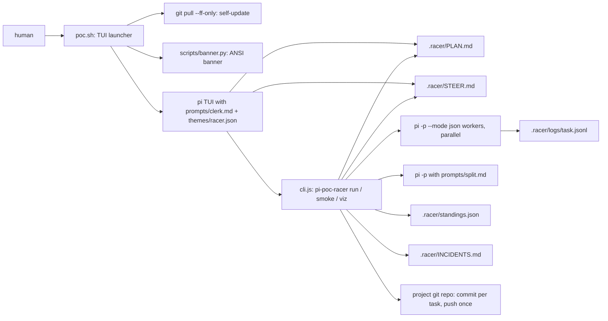
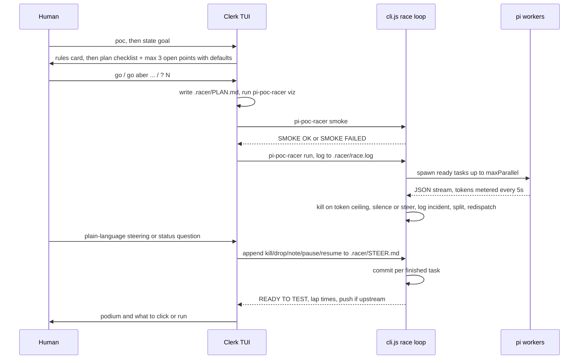

# pi-poc-racer

Race-to-proof-of-concept orchestrator for the [pi](https://github.com/earendil-works/pi-coding-agent) coding agent.
The Clerk of the Course (a pi TUI persona) plans with you in one round, then a zero-dependency Node CLI races parallel pi workers, kills any over budget, splits the task and redispatches.
For developers who want a clickable demo or a CLI result fast. No tests get written: "done" means a demo you can click or a CLI that prints the result.

## Logs

- [CHANGELOG.md](CHANGELOG.md): release notes per commit
- [PROMPTLOG.md](PROMPTLOG.md): rules and prompts given by the owner

## Status

| field | value |
|---|---|
| version | v0.5.0 (package.json `0.5.0`) |
| date | 2026-10-14 |
| updated by | hermes-agent for emino |
| default branch | `master`, HEAD `e55292fe` |
| deployment | not documented in repo (local CLI, installed via `npm link`) |

Spawned from ideas in [pi-messenger-swarm](https://github.com/monotykamary/pi-messenger-swarm) (task board, `pi --mode json` spawning), rebuilt as a standalone CLI so the constraints live in code, not in LLM discipline.

## Architecture



The race loop in `cli.js` is plain Node code, no LLM. LLM calls happen only in workers, in the split prompt, and in the Clerk TUI.

## User flow



## Components

| component | path | role |
|---|---|---|
| race CLI | `cli.js` | `run`, `smoke`, `viz` commands; worker spawn, metering, kill, split, steer, standings, commits, push |
| TUI launcher | `poc.sh` | self-update via `git pull`, version line, banner, starts clean-room `pi` with Clerk prompt and racer theme |
| Clerk prompt | `prompts/clerk.md` | Clerk of the Course persona: rules card, one-round plan, smoke before race, steering translation, pit-radio voice |
| split prompt | `prompts/split.md` | turns a killed task into 2-4 smaller tasks (ids like `t3a`, each under 40000 estTokens) |
| theme | `themes/racer.json` | pi TUI color theme `racer` |
| banner renderer | `scripts/banner.py` | renders the POC RACER pixel banner to ANSI at terminal width (needs Pillow) |
| banner assets | `themes/banner.ansi`, `themes/banner-preview.png` | prerendered banner and preview |
| package | `package.json` | bins `pi-poc-racer` -> `cli.js`, `poc` -> `poc.sh`; Node >= 20; no dependencies |

## API / Endpoints

No HTTP routes. CLI commands and file-based steering only.

| type | name | purpose |
|---|---|---|
| CLI | `poc [pi args]` | open the Clerk TUI in the current project |
| CLI | `pi-poc-racer run` | race the tasks in `.racer/PLAN.md` until READY TO TEST |
| CLI | `pi-poc-racer smoke` | spawn one tiny worker; exit 0 only if it succeeds and tokens are metered |
| CLI | `pi-poc-racer viz` | print the plan as an indent tree with Test lines and dependencies |
| CLI | `pi-poc-racer viz --mermaid` | print the plan as a Mermaid `graph LR` |
| steer | `kill <id>` | kill worker, split task smaller, redispatch |
| steer | `drop <id>` | kill or cancel task, no replacement |
| steer | `note <id> <text>` | team order appended to the (re)spawned worker prompt |
| steer | `pause` / `resume` | stop or restart new dispatches; running workers finish |

Steer commands are lines appended to `.racer/STEER.md`. The race loop reads and clears the file every loop pass (about 2s). The Clerk writes them for you from plain language.

## Kill rules

| meter | default | why |
|---|---|---|
| total tokens | over `POC_TOKEN_CEILING` (100000) | task was not split small enough: a planning failure |
| silence | no output for `POC_SILENCE_MS` (180000 ms) | stuck process burns zero tokens and would never trip the token meter |
| crash | non-zero exit | worker failed |
| steer | `kill` / `drop` in STEER.md | human decision |

Every kill except `drop` writes an entry to `.racer/INCIDENTS.md` and asks the split prompt for smaller tasks.

Why tokens and not time: a token ceiling measures plan granularity. A silence timeout measures stuckness. You need both meters.

## State files

All state lives in `.racer/` of the project you run it in.

| file | what |
|---|---|
| `.racer/PLAN.md` | agreed plan, one fenced json block: `maxParallel`, `tasks[]` with `id`, `title`, `files`, `dependsOn`, `estTokens`, `doneWhen` |
| `.racer/standings.json` | live standings: status, tokens, last output, lap seconds per task |
| `.racer/INCIDENTS.md` | kill log with reason and lesson |
| `.racer/STEER.md` | steering inbox, consumed and cleared by the race loop |
| `.racer/race.log` | race output, written when the Clerk starts `run` in the background |
| `.racer/logs/<task>.jsonl` | raw worker output |

## Commit policy

- After each finished task: `git add` only that task's `files`, then commit `racer(<id>): <title>`.
- Files over 50 MB are unstaged before commit.
- One push at READY TO TEST, only if the branch has an upstream. On rejection: `pull --rebase --autostash`, one retry.

## Run

Requires Node >= 20 and the `pi` CLI installed and authenticated. The `poc` banner needs `python3` with Pillow; failures are ignored.

```bash
npm link                    # from this repo: installs bins pi-poc-racer and poc
cd /path/to/your/project
poc                         # Clerk TUI: state the goal, answer go
pi-poc-racer smoke          # harness check, also run by the Clerk
pi-poc-racer run            # race .racer/PLAN.md
pi-poc-racer viz --mermaid  # plan graph
```

No test suite in the repo. `pi-poc-racer smoke` is the harness check.

Env vars read by the code:

| var | default | read in | meaning |
|---|---|---|---|
| `POC_TOKEN_CEILING` | `100000` | `cli.js` | kill a worker past this many total tokens |
| `POC_SILENCE_MS` | `180000` | `cli.js` | kill a worker silent this long |
| `POC_PI_MODEL` | `kimi-coding/k3` | `cli.js` | model for workers and split calls |
| `POC_WORKER_THINKING` | `low` | `cli.js` | worker thinking level, appended as `model:level` |
| `POC_CLERK_MODEL` | `kimi-coding/k3:medium` | `poc.sh` | model and thinking for the Clerk TUI |
| `PI_OFFLINE` | set to `1` | `poc.sh` | exported by `poc.sh` to suppress pi update banners |

## Clean-room TUI

`poc` starts pi with `--no-skills --no-extensions --no-context-files --no-prompt-templates --no-themes` and writes `.pi/settings.json` with `quietStartup: true` if missing. The only system prompt is the Clerk. Workers run with `--no-skills --no-extensions --no-context-files`. Worker rules live in the worker prompt itself: touch only owned files, smallest change that works, no new dependencies, no questions.

## Rules of the race

1. Only the CLI spawns workers. The Clerk never edits project code and never touches worker processes.
2. One shared checkout. Parallel tasks own disjoint files (set in `PLAN.md`).
3. Workers never ask questions. They decide and move.
4. Unlimited kill-split-redispatch rounds until READY TO TEST.

## Known limits

- `scripts/banner.py` loads source images from hardcoded macOS temp paths (`/var/folders/...`). On other machines the banner render fails silently and `poc` starts without it.
- `poc.sh` runs `git pull --ff-only` on the install directory at every launch.
